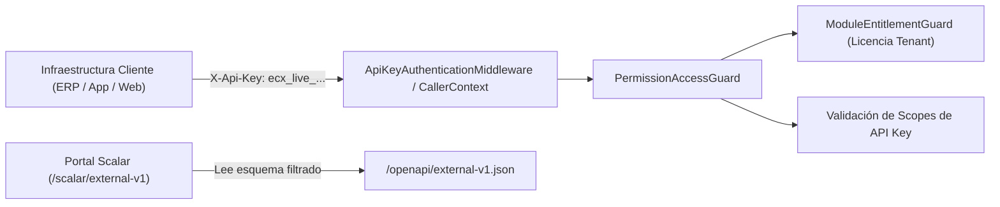

# Technical Implementation Plan: `001-tenant-developer-api`

- **Feature**: API Pública y Portal de Desarrolladores por Empresa
- **Spec Reference**: `specs/001-tenant-developer-api/spec.md`
- **Architecture Compliance**: Clean Architecture + DDD (`EcuNexo.Core`, `EcuNexo.Data`, `EcuNexo.Business`, `EcuNexo.Api`) + `ecunexo_admin` (React + Vite + glubox)

---

## 1. Arquitectura de Solución

---

## 2. Diseño por Capas

### 2.1 `EcuNexo.Core` (Dominio)
- **Entidad `TenantApiKey`** (`EcuNexo.Core/Identity/TenantApiKey.cs`):
  - Implementa `ITenantEntity`, `IAuditableEntity`, `ISoftDeletable`.
  - Propiedades:
    - `Id` (`Guid`, UUID v7)
    - `TenantId` (`Guid`)
    - `Name` (`string`, máx. 120 chars)
    - `KeyPrefix` (`string`, máx. 24 chars, ej. `ecx_live_a1b2c3d4`)
    - `KeyHash` (`string`, SHA-256 hex de 64 chars)
    - `Scopes` (`IReadOnlyList<string>` persistido como `jsonb`)
    - `CreatedByUserId` (`Guid`)
    - `ExpiresAt` (`DateTimeOffset?`)
    - `RevokedAt` (`DateTimeOffset?`)
    - `LastUsedAt` (`DateTimeOffset?`)
  - Métodos de dominio: `Create(...)`, `Revoke(DateTimeOffset utcNow)`, `IsActive(DateTimeOffset utcNow)`, `HasScope(string permissionCode)`.
- **Repositorio `ITenantApiKeyRepository`** (`EcuNexo.Core/Identity/ITenantApiKeyRepository.cs`):
  - `GetActiveByPrefixAsync(string keyPrefix, CancellationToken ct)`
  - `GetByIdAsync(Guid tenantId, Guid apiKeyId, CancellationToken ct)`
  - `ListByTenantAsync(Guid tenantId, CancellationToken ct)`
  - `AddAsync(TenantApiKey apiKey, CancellationToken ct)`
  - `TouchLastUsedAsync(Guid tenantId, Guid apiKeyId, DateTimeOffset usedAt, CancellationToken ct)`

### 2.2 `EcuNexo.Data` (Persistencia PostgreSQL / EF Core)
- **Configuración `TenantApiKeyConfiguration`**:
  - Tabla `tenant_api_keys`.
  - Índice único en `key_prefix` (`ix_tenant_api_keys_key_prefix`) para búsqueda $O(1)$ en cada request.
  - Índice compuesto en `(tenant_id, created_at)` para el listado en el panel admin.
  - Columna `scopes` como `jsonb`.
  - Global Query Filter por `TenantId` y `DeletedAt == null`.
- **Migración EF Core**: `AddTenantApiKeys`.

### 2.3 `EcuNexo.Business` (Casos de Uso y Seguridad)
- **Catálogo de Scopes Permitidos (`DeveloperApiScopes`)**:
  - Define qué códigos de permiso pueden asignarse a una API Key externa (ej. `catalog.products.read`, `catalog.products.write`, `catalog.categories.read`, `inventory.stock.read`, `inventory.movements.read`, `warehousing.warehouses.read`, `customers.read`, `customers.write`, `ecommerce.orders.read`, `pricing.promotions.read`).
  - Bloquea permisos sensibles internos (`identity.users.*`, `identity.roles.*`, `tenancy.*`).
- **Extensión de `ICallerContext` y `PermissionAccessGuard`**:
  - `ICallerContext` expone `Guid? ApiKeyId`, `IReadOnlySet<string>? ApiKeyScopes` y `bool IsApiKeyCaller`.
  - En `PermissionAccessGuard.RequireAsync`:
    - Si `IsApiKeyCaller == true`:
      1. Verifica que `tenantId` de la ruta coincida con `ExplicitTenantId` de la API Key (`auth.tenant.mismatch` si difiere).
      2. Verifica que el módulo esté contratado (`_modules.RequireModuleForPermissionAsync`).
      3. Verifica que `normalizedCode` esté contenido en `ApiKeyScopes` (`auth.api_key.scope_denied`).
- **Commands & Queries (`EcuNexo.Business/Identity/ApiKeys/`)**:
  - `CreateTenantApiKeyCommand` / `Handler`: Valida scopes contra `DeveloperApiScopes` y contra los módulos contratados del tenant, genera token criptográfico (`RandomNumberGenerator.GetBytes(32)`), persiste hash y devuelve el `PlainTextKey` una sola vez.
  - `ListTenantApiKeysQuery` / `Handler`: Lista las llaves del tenant sin exponer el hash.
  - `RevokeTenantApiKeyCommand` / `Handler`: Marca `RevokedAt = TimeProvider.GetUtcNow()`.

### 2.4 `EcuNexo.Api` (Autenticación M2M, Endpoints y OpenAPI Externo)
- **Middleware / Handler `TenantApiKeyAuthMiddleware`**:
  - Lee la cabecera `X-Api-Key` (si no viene un `Authorization: Bearer` de usuario).
  - Extrae el `KeyPrefix`, consulta con caché en memoria corta (`IMemoryCache`, 30s TTL invalidable al revocar) para evitar golpear PostgreSQL en cada llamada de alto volumen, verifica el hash SHA-256 con `CryptographicOperations.FixedTimeEquals`, valida expiración y pobla `HttpContext.Items` + `ITenantContext`.
- **Rate Limiting para API Keys**:
  - Política `TenantApiKeyRateLimit` particionada por `KeyPrefix`.
- **Endpoints de Gestión (`/api/v1/tenants/{tenantId}/api-keys`)**:
  - `GET /api/v1/tenants/{tenantId}/api-keys`
  - `POST /api/v1/tenants/{tenantId}/api-keys`
  - `DELETE /api/v1/tenants/{tenantId}/api-keys/{apiKeyId}`
- **Documento OpenAPI Externo (`external-v1`) + Portal Scalar**:
  - Se registra un segundo documento OpenAPI: `builder.Services.AddOpenApi("external-v1", ...)` con:
    - `ExternalApiDocumentTransformer`: Define el título `"EcuNexo Developer API (Empresas)"`, la descripción de integración y el esquema `ApiKeyAuth` (`X-Api-Key`).
    - Filtro de inclusión (`ShouldInclude`): Incluye únicamente los grupos de endpoints marcados con `.WithMetadata(new ExternalDeveloperApiAttribute())` (Catálogo, Inventario, Bodegas, Clientes, Pedidos Ecommerce, Precios).

### 2.5 `Cliente/ecunexo_admin` (UI Portal de Desarrolladores)
- Nueva vista bajo Configuración / Desarrolladores (`DeveloperApiPage.tsx`) siguiendo el sistema `glubox-enterprise-ui`:
  - `PageHeader` con botón **"Nueva API Key"** y enlace directo a **"Abrir Documentación Interactiva (Scalar)"**.
  - `StatCard`s (Llaves Activas, Scopes Habilitados, Endpoint Base + Tenant ID copiable).
  - `SectionCard` con guía rápida de autenticación (`X-Api-Key` + ejemplo cURL con el `tenantId` real de la empresa).
  - `DataGrid` de API Keys con búsqueda integrada y columna **Acciones** (`sticky: 'right'`) para revocar.
  - Modal de creación con selector de Scopes agrupados por módulo y modal de visualización única del secreto generado con botón de copiado.
